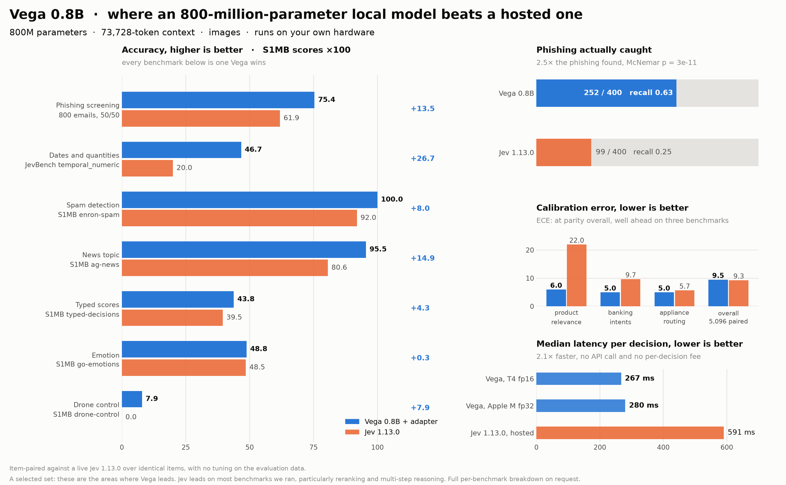

# vegaml

Typed decisions from a frozen language model and a small physics engine. You give it a **state** and a
**question whose answer type is fixed in advance**; it returns a value your code can use directly — a
choice, a 0–1 score, or the probability that a statement is true — each with a calibrated probability,
a conformal answer set and an explicit abstain flag.

**800M parameters · 73,728-token context · images · runs on your own hardware.** No text is generated
anywhere in the path.



```bash
pip install vegaml
```

## Quick start

```python
import vegaml

v = vegaml.load("nandakishorm/vega-08b-public-intents")      # mode="engine" by default

out = v.decide(
    {"from": "billing@acme.com", "subject": "Invoice overdue", "body": "Third notice. Pay now."},
    {"team":  {"type": "choice", "instructions": "Which team should handle this?",
               "criteria": {"billing": "payments and invoices",
                            "technical": "product faults",
                            "sales": "new business"}},
     "churn": {"type": "noul", "instructions": "Is this customer at risk of leaving?",
               "criteria": {"true": "shows intent to cancel", "false": "no such signal"}}})

print(out["answers"]["team"]["choice"])        # 'billing'
print(out["answers"]["team"]["probs"])         # calibrated, sums to 1
print(out["answers"]["churn"]["abstain"])      # False -> the engine stands behind it
```

Both questions are answered from **one** read of the state.

### Two readouts, one set of features

`mode` picks how the pooled features are turned into an answer.

| mode | needs examples | carries | use it when |
|---|---|---|---|
| `"engine"` *(default)* | no, zero-shot | calibration, conformal sets, abstain | the normal case, and every published figure below |
| `"ttt"` | yes, 6 minimum | nothing — it answers even when it should not | you have labels for exactly this question |
| `"both"` | yes | both, side by side | deciding which to trust |

```python
examples = [({"body": "cancel my account"}, {"churn": "true"}),
            ({"body": "how do I export?"},  {"churn": "false"})]            # ... 20 or so

report = v.fit(examples, questions)
print(report["churn"]["cv_accuracy"], report["churn"]["at_or_below_chance"])

out = v.decide(state, questions, mode="ttt")
```

`fit` returns a cross-validated accuracy per question. **Read it.** A head at or below chance has
learned nothing and its probabilities are noise; the engine is the honest answer there.

### Images

```python
from PIL import Image

v.decide_image(Image.open("invoice.png"),
               {"kind": {"type": "choice", "instructions": "What kind of document is this?",
                         "criteria": {"invoice": "a bill", "receipt": "proof of payment",
                                      "form": "a document to be filled in", "other": "none of these"}}})
```

The backbone is multimodal and its vision encoder is frozen with the rest, so a picture takes the place
of the state text in the same prompt and the same spans are pooled. The benchmark figures below are
text; the image path is functional but not covered by them.

### 73,728-token context

`max_len` is 73,728 tokens, and the architecture is built for it rather than merely permitting it:

* **Read-once prefix caching.** A state of at least 4,096 tokens is encoded **once**; every question
  about that state continues from a copy of that prefix. Twelve questions about one 73k-token contract
  cost roughly one read, not twelve.
* **A memory reader.** Long states are cut into 16 pieces, mean-pooled at the deepest feature layer and
  fed to the engine alongside the spans, so evidence late in a long document still reaches the decision.
* **No silent truncation.** An input that will not fit is refused, never quietly shortened.

## Benchmarks

The figure at the top of this page is the table below. Item-paired against a live Jev 1.13.0 over
identical items, no tuning on the evaluation data. These are the areas where this model leads; the
reference leads on most others, particularly reranking and multi-step reasoning.

| task | this model | Jev 1.13.0 |
|---|---|---|
| Phishing screening, 800 emails | **75.4** acc · **252/400** caught · recall **0.63** | 61.9 · 99/400 · 0.25 |
| Dates and quantities (temporal_numeric) | **46.7** | 20.0 |
| Spam detection (enron-spam) | **1.000** | 0.920 |
| News topic (ag-news) | **0.955** | 0.806 |
| Typed scores (typed-decisions) | **0.438** | 0.395 |
| Calibration error, product relevance | **6.0** | 22.0 |
| Calibration error, overall (5,096 paired) | 9.5 | 9.3 |
| Median latency per decision | **267 ms** (T4 fp16) · 280 ms (Apple M, fp32) | 591 ms (hosted) |

2.5× the phishing caught at McNemar p = 3e-11, and 2.1× faster with nothing leaving the machine.

## How it works

One prompt, one forward pass, then physics.

**1 — One formatted prompt.** The state, the question and every candidate answer are written into a
single sequence:

```
Observation: {state} Measurement ({type}): {instructions} Possible outcomes: * {option 1} * {option 2} Outcome:
```

The option text is genuinely part of the model's input, not metadata kept outside it. No system prompt,
no chat template, no demonstrations, and the gold answer never appears — it exists only as a training
label.

**2 — One forward pass, five pooled vectors.** The frozen language model runs **once** over that
sequence. Vega then pools different token spans from the *same* hidden states: the situation span, the
question span, one span per answer option, and the final token. Three questions about one state mean
three prompts and three passes, except for the long-input case above, where the prefix is shared.

**3 — Pooled vectors become initial conditions.** The situation vector projects to a world latent and
gets a bounded nonlinear nudge; the question and the final token project to a probe and an impulse.
Together they place a particle at position `z₀` with momentum `p₀` in a 64-dimensional decision space.

**4 — Every candidate answer becomes a valley.** Each option's own features produce a Gaussian well —
a centre `c_k`, a depth `a_k` and a width `σ_k`:

```
U(z) = ½κ‖z‖² − Σ_k a_k · exp( −‖z − c_k‖² / 2σ_k² )
```

The quadratic term keeps the particle bounded; each well pulls it toward one answer. Score levels sit on
a one-dimensional rail, so ordinal neighbours are physical neighbours.

**5 — The particle rolls and settles.** Damped Hamiltonian dynamics — symplectic Euler with friction and
a learned state-space thermostat — for a fixed, small step budget, with early exit once it has settled.
A decision is a short simulation with constant cost, not a sampling loop, so it is deterministic.

**6 — Where it settles is the answer.**

```
E_k = ‖z_T − c_k‖² / 2σ_k² − log a_k            P = softmax(−E / τ)
```

### What is new here

**The architecture.** The language model is frozen and never trained — it is perception only, read at
two intermediate layers and cut off above the deepest one, so a decision never pays for the layers above
it and the LM head never runs. Everything learned lives in a 55 MB engine whose state is a *physical*
one: a position and a momentum, not a logit vector.

**The training method.** The engine is trained on the settling behaviour, not on next-token likelihood:
a counterfactual objective pairs items that share an answer space, and a one-step world-dynamics block
is trained to imagine the next state from the current one, so the latent carries what happens next
rather than only what was said. Two low-rank adapters (rank 32) attach to seven engine projections, and
a per-question sigmoid gate decides **for each question independently** whether an adapter contributes.
The gate value and the chosen adapter are returned with every answer, so routing is auditable rather
than implicit.

**The calibration method.** The readout temperature is not a constant. It is predicted per decision from
the physical state the particle ended in:

```
log τ = b + w · [ log(1 + residual kinetic energy),
                  log(1 + distance to the nearest well bottom),
                  fraction of the step budget used,
                  log (number of options) ]
```

A particle still in motion, or stopped far from every well, is an uncertain decision and gets a hotter
temperature. Each adapter route carries its own calibration vector. On top of that, every answer has a
split-conformal set at a chosen risk level, an **abstain** flag below a fitted confidence floor, and an
**unbound** flag when the particle settled far from every well — the model's own way of saying the
question is outside what it knows.

## Security

A checkpoint is data from a third party, so the inference code lives in this package and is reviewed
with it. `vegaml.load()` downloads **only** `vega_config.json`, `engine.safetensors` and the adapter
files; nothing fetched at runtime is imported or executed, and weights load through safetensors, never
pickle. Tests enforce that allow-list, and CI fails on any `pickle`, `torch.load`, `eval`, `exec`,
`subprocess` or `sys.path` insertion reaching the shipped package.

## Repository settings worth knowing

Two things this repository cannot enforce on a private repo without a paid plan, documented here so
nobody mistakes a gap for a gate:

* **Branch protection.** Both classic protection and rulesets return `403 Upgrade to GitHub Pro or
  make this repository public`, so the server enforces nothing: a force-push to `main`, a deletion,
  or a merge over a red check are all possible. The workflows still run on every push and pull
  request; only the enforcement is missing.

  The nearest available substitute is a local hook, `.githooks/pre-push`, which refuses a force-push
  or a deletion of `main`. Enable it in each clone with `git config core.hooksPath .githooks`. It
  stops the accident from a configured clone and **nothing else** — not another machine, not the web
  UI, not `--no-verify`. Treat it as a seatbelt, not a lock.
* **CodeQL.** Code scanning needs GitHub Advanced Security on a private repository
  (`422 Advanced security has not been purchased`), so the CodeQL job reports why it skipped instead
  of failing forever. Secret scanning, the dependency CVE audit and the supply-chain gate do run.

Making the repository public, or upgrading, turns both on with no change to the workflows.

## Licence

Apache 2.0.
