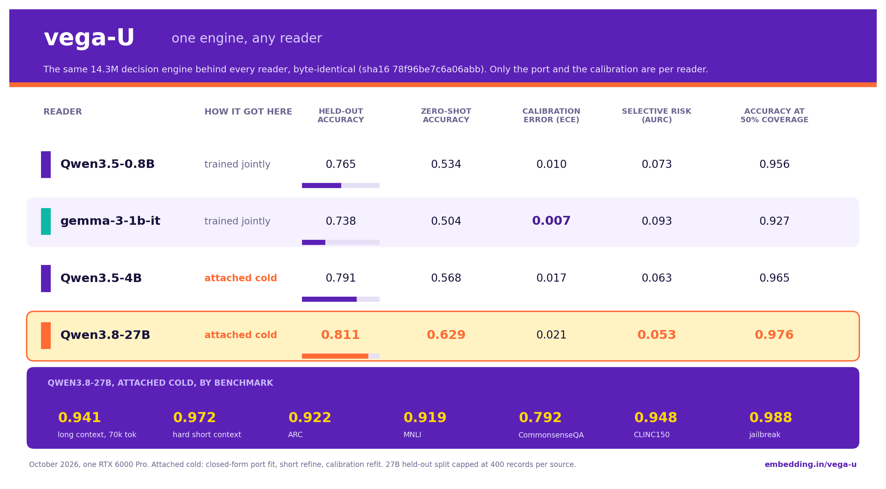
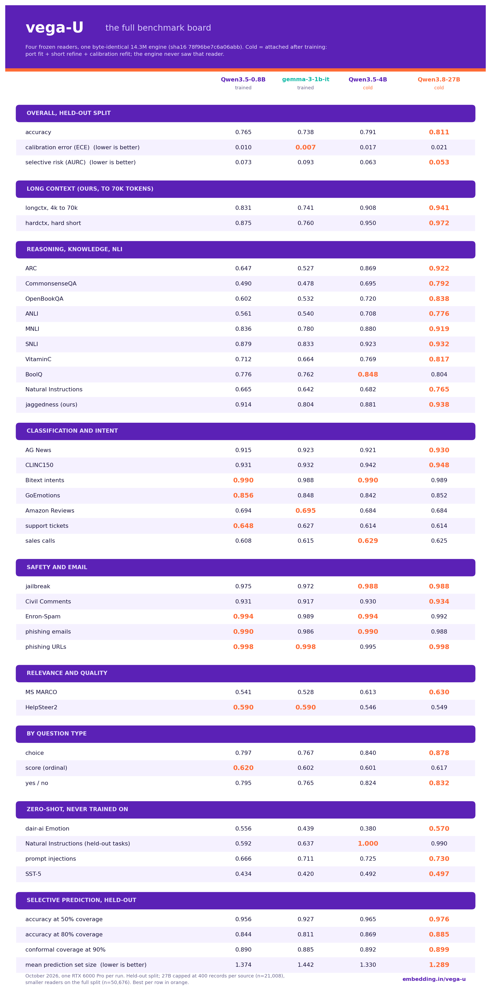

# vega-U: the universal checkpoint

vega-U decouples the decision engine from the LLM that reads for it. One 14.3M engine lives
in a shared 1024-dimensional feature space, and every reader, from a 0.8B to a 27B, plugs
into that space through a **port**: one small linear map per tapped layer. The engine bytes
are identical behind every reader (the publish step asserts the checksum); only the port and
the per-reader calibration differ. The reader is never fine-tuned, and the engine is never
retrained to add one.



## Loading

vega-U is the default model from vegaml 0.11. Changing the base model is naming it,
nothing else:

```python
import vegaml

v = vegaml.load()                                 # nandakishorm/vega-U, root reader (0.8B)
v = vegaml.load("4b")                             # the Qwen3.5-4B reader, same engine
v = vegaml.load("gemma-1b")                       # the Gemma 3 1B reader, same engine
v = vegaml.load(backbone="Qwen/Qwen3.5-4B")       # any reader, named by its own repo id
v = vegaml.load(backbone="google/gemma-3-1b-it")  # gated reader: set HF_TOKEN
v = vegaml.load("outputs/universal/per_backbone/Qwen3.5-4B")   # a training run's dir on disk
```

On a universal checkpoint, `backbone=` names WHICH reader. The last path component of the id
("gemma-3-1b-it") selects the directory inside the repo that carries that reader's port and
calibration; the reader's own weights still come from their original repository. Asking for
a reader the checkpoint ships no port for fails with the list of readers it does ship. On a
classic (non-universal) checkpoint, `backbone=` keeps its old meaning: an alternate location
of the same backbone.

Tokens belong to the reader, not to vega-U: Qwen readers load with no token, Gemma 3 is
gated, so `HF_TOKEN` must be set and the licence accepted on the Hub.

## What a universal checkpoint contains

A vega-U directory is a classic vega model dir plus two files, named by two keys in
`vega_config.json`:

| file | config key | holds |
| --- | --- | --- |
| `port.safetensors` | `port` | this reader's linear maps into the shared space |
| `stats.npz` | `raw_stats` | the reader's feature statistics from extraction |

At load time the runtime sees the `port` key, standardizes raw perception features with
`stats.npz`, maps them through the port, and runs the shared engine there. `decide()` and
everything downstream are identical to a classic checkpoint. In the Hub repository the root
is one reader (so the plain repo id loads with no subfolder) and every other reader is a
self-contained subfolder; `universal/` carries the shared-space targets and ports that the
training-side attach tooling uses to add the next reader: a closed-form port fit against
stored targets, a short refine against the frozen engine, and a calibration refit.
Calibration never transfers between readers, so each directory ships its own.

## Measured, October 2026

Trained jointly on Qwen3.5-0.8B and Gemma 3 1B (708,657 uid-matched items, records up to
73,728 tokens, a cross-reader invariance loss pulling the same item's ported features
together across tokenizers). The 4B and the 27B were attached cold afterwards, and every
cold-attached reader scored above the readers the engine trained with:

| reader | how | held-out acc | zero-shot acc | ECE | AURC | acc @ 50% cov |
|---|---|---|---|---|---|---|
| Qwen3.8-27B | attached cold | **0.811** | **0.629** | 0.021 | **0.053** | **0.976** |
| Qwen3.5-4B | attached cold | 0.791 | 0.568 | 0.017 | 0.063 | 0.965 |
| Qwen3.5-0.8B | trained jointly | 0.765 | 0.534 | 0.010 | 0.073 | 0.956 |
| gemma-3-1b-it | trained jointly | 0.738 | 0.504 | 0.007 | 0.093 | 0.927 |

The gains land where reading matters and nowhere else, which is exactly the design's claim.
Per source, 0.8B against 27B: long context to 70k tokens 0.831 to 0.941, hard short context
0.875 to 0.972, ARC 0.647 to 0.922, CommonsenseQA 0.490 to 0.792, OpenBookQA 0.602 to 0.838,
ANLI 0.561 to 0.776, MNLI 0.836 to 0.919. Saturated perception tasks stay flat across all
four readers (Bitext intents 0.99, Enron-Spam 0.99, phishing 0.99, AG News 0.92 to 0.93),
and the ordinal `score` question type sits near 0.61 for every reader: that ceiling belongs
to the engine or the labels, not the reader.



Caveats that belong next to the numbers: the 27B's held-out split is capped at 400 records
per source (n=21,008) while the smaller readers are scored on the full split (n=50,676), and
each run's raw per-source detail ships as `eval_report.json` in its reader directory.

## What changed, by version

- **0.10.0**: universal checkpoints load. `Vega` recognises the `port` key, wraps the engine
  in the standardize-then-port step, and the Hub allow-list gains `port.safetensors` and
  `stats.npz` (the npz is read with `allow_pickle=False`, pinned by a test).
- **0.10.1**: `backbone=` names the reader. The matching directory is selected by name, its
  subfolder is fetched under the same data-only allow-list, and a missing port fails with
  the list of readers the checkpoint ships.
- **0.11.0**: vega-U becomes the default. `load()` with no argument is the universal 0.8B;
  `"4b"` and `"gemma-1b"` pick other readers of the same engine. The earlier per-size
  checkpoints stay loadable by their full repository id.
